# Ellis

### Reliability and governance for a multi-agent AI platform

[](https://github.com/qninying/platform-reliability-agent/actions/workflows/ci.yml)

**Ellis watches the AI agents that run the Colaberry platform. It tells a person, with evidence, what is
healthy, what is broken, and what it cannot see.** It is an AI agent built in phases: this phase builds its
evidence and judgement layer, read-only, against the real platform's code and records.

| | |
|---|---|
| **Engineering ownership** | Quincy Nkwain Ninying: system architecture and forward-deployed engineering |
| **Platform** | [Colaberry platform](https://github.com/ColaberryIntern/ColaberryEnterprise_AI_LeadershipAccelerator) (public): 100+ scheduled agents, Node, TypeScript, PostgreSQL |
| **Capabilities** | 24 of 48 verified by the platform ([catalog](docs/capabilities/README.md)) |
| **Tests** | 303 passing, each capability's key rules shown to fail when broken ([how](docs/decisions/004-prove-each-test-can-fail.md)) |
| **Autonomy** | every capability starts at R0; first releases at R2 (answer from records), with two at R4 and one at R1, all in a sandbox |
| **Production writes** | none: read-only, or a sandbox copy ([decision 001](docs/decisions/001-read-only-first-sandbox-for-change.md)) |
| **Runtime dependencies** | none (Node 23.6+ runs the TypeScript directly) |
| **Oversight** | K.D. (AI Engineer, manager) approves promotions and any production action; A.M. reviews platform findings and governance |

## The problem

A platform run by a hundred scheduled AI agents can look healthy while it is not. Uptime checks say the
process is up; they do not say whether each agent did its work. Reading the platform's code while building
Ellis turned up the ways this happens, each with file:line references:

- **Silence reads as health.** A security director stayed "normal" because no threat arrived from a scanner
  that never ran.
- **Failures are recorded as successes.** A wrapper shared by 104 agents logged a failed run as "no issues".
- **Records say work happened when it did not.** A bug-fix agent told reviewers "Auto-fix has been applied"
  when nothing was changed.
- **Controls that do not control.** Pause was ignored by five timers, so a paused agent kept running.
- **Scores that mean nothing.** An agent that has never run shows a health score of 100, in green.

Ellis answers one operational question per capability, and every answer separates three things the
platform often merges: *healthy*, *broken*, and *unknown*.

## How Ellis is built

| Principle | What it means in the code |
|---|---|
| **Unknown is never healthy** | A scanner that did not run, scanned 0 files or is switched off reads `unknown`, and a rollup over it can never be green ([decision 002](docs/decisions/002-unknown-is-not-healthy.md), [`securityOversightRollup.ts`](src/capabilities/securityOversightRollup.ts)) |
| **Evidence over assertion** | Every verdict cites the table and row id it came from, so a reviewer can check it |
| **Bounded autonomy** | Read-only by type: capabilities see the platform through an interface with no write method ([`readSource.ts`](src/readSource.ts)) |
| **Pinned to the platform** | Every copied rule names the platform commit and file:line it came from; `--source` re-reads it live and fails if it changed shape ([decision 003](docs/decisions/003-pin-to-platform-code.md)) |
| **Prove the test can fail** | For each capability, key rules are deliberately broken and a named test is confirmed to fail ([decision 004](docs/decisions/004-prove-each-test-can-fail.md)) |
| **Verify after a change** | In the sandbox, each changed value is read back, and a second run must change nothing ([example below](#end-to-end-a-repair-proven-safe-to-repeat)) |

## Architecture



Diagram source: [`overview.mmd`](docs/architecture/overview.mmd), rendered to SVG with Mermaid (plain text labels).

Ellis holds no credentials and has no network path to the platform. Detail, layers and the sandbox
boundaries: [docs/architecture](docs/architecture/README.md).

## Autonomy: where Ellis is, and what moves it

The platform defines an R0 to R9 ladder per capability
([`autonomyLadder.ts:59-68`](https://github.com/ColaberryIntern/ColaberryEnterprise_AI_LeadershipAccelerator/blob/44430870b/backend/src/services/agentDomain/autonomyLadder.ts#L59-L68)).
Ellis climbs it one step at a time, on evidence K.D. approves.

| Level | Platform meaning | Ellis today |
|---|---|---|
| R0 | Define the workflow, requirements, risks and human decisions | every capability starts here ([discovery](docs/discovery/)) |
| R1 | Prepare isolated development, fixtures and baseline tests | bug fix dispatch: a sealed baseline test, run in a locked sandbox |
| R2 | Answer questions using approved knowledge and records | 17 first releases: report and recommend, change nothing |
| R4 | Execute and verify stateful, multi-step sandbox tasks | auto-repair and ticket resolution, on sandbox copies only |
| R5 | Evaluate in shadow mode against approved reference outcomes | next step for monitoring, once K.D. sets the acceptable misses and false alarms |
| R6+ | Supervised production pilot, then authorized automation | not started; each needs its own approval |

## Capabilities

| Domain | Built | What it covers |
|---|---|---|
| Reliability engineering | 7 | orchestration health, stuck actions, resilience, cron runs, cron health alerts, agent health scores, timer and agent registry reconciliation |
| Security and AI safety | 4 | secret, code and dependency scans; admin access; agents acting outside their grants; one security verdict |
| Agent operations and governance | 4 | agent registry, enable and disable control, technology direction, data retention |
| Controlled remediation, sandbox only | 3 | auto-repair, ticket auto-resolution, bug baselines |
| Platform optimisation and change | 3 | prompt cost and speed, evolution proposals, preview stacks |

Each row in the [capability catalog](docs/capabilities/README.md) links to a write-up: the question it
answers, how the answer is decided, what the platform code showed, and the evidence. 27 more capabilities
are planned in the platform's build plan for this domain.

## End to end: a repair proven safe to repeat

The platform's auto-repair agent fixes broken prompt links on a timer, every minute. Ellis runs the same two
authorized repairs, but only on a sandbox copy, and proves that running them twice changes things once.

```
npm run orchestration-repair -- --fixture examples/orchestration-repair.fixture.json
```

1. **Signal.** Six fault events, shaped like the platform's `ai_system_events` rows: one of each authorized
   kind, a duplicate (the monitor runs every minute), and faults Ellis must not touch.
2. **Plan.** Each fault is matched against the authorized repair set and an allowlist of columns. A fault
   outside the set is reported, not improvised on.
3. **Act, in the sandbox.** Every write goes through a store that journals it.
4. **Verify.** Each changed value is read back; any mismatch marks the run failed
   ([`orchestrationAutoRepair.ts:92`](src/capabilities/orchestrationAutoRepair.ts#L92)).
5. **Repeat.** A second run must make no change, counted from the journal.

Excerpt of the real output on that fixture (trimmed; the fixture is test data, not production):

```json
{
  "runs": [
    { "run": 1, "outcome": "changed", "verified": true,
      "applied": [ { "table": "prompt_templates", "row_id": "prompt-off", "column": "is_active",
                     "from": false, "to": true, "repair_class": "inactive_prompt_reactivation" }, "...3 more" ],
      "no_op": [ { "fault_id": "evt-2", "reason": "duplicate signal: prompt_templates:prompt-off:is_active is already planned by an earlier fault" } ],
      "left_alone": [ "...2 more", { "fault_id": "evt-6", "event_type": "gating_deadlock",
                      "reason": "outside the authorized repair set; reported, not repaired" } ] },
    { "run": 2, "outcome": "no_op", "verified": true, "applied": [] }
  ],
  "total_changes": 4
}
```

6. **Approval boundary.** A production pilot is R6 and needs K.D.'s separate approval. One of the two repairs
   can undo a person's deliberate decision, so it needs K.D.'s decision before any production pilot ([write-up](docs/capabilities/orchestration-auto-repair.md)).

## Findings that changed the platform

Each capability starts by reading the platform code it depends on. The weaknesses found go to A.M., who
verifies each one against the code. Five fixes are merged in the platform repository, each crediting the
findings by number:

| Pull request | What it fixed |
|---|---|
| [#3410](https://github.com/ColaberryIntern/ColaberryEnterprise_AI_LeadershipAccelerator/pull/3410) | Security and orchestration: nine findings |
| [#3422](https://github.com/ColaberryIntern/ColaberryEnterprise_AI_LeadershipAccelerator/pull/3422) | The scheduler sending a lead the same message twice |
| [#3430](https://github.com/ColaberryIntern/ColaberryEnterprise_AI_LeadershipAccelerator/pull/3430) | Pause not containing an agent |
| [#3435](https://github.com/ColaberryIntern/ColaberryEnterprise_AI_LeadershipAccelerator/pull/3435) | A bug-fix agent saying a fix was applied when none was |
| [#3439](https://github.com/ColaberryIntern/ColaberryEnterprise_AI_LeadershipAccelerator/pull/3439) | A failed run undoing a pause set while it ran |

The pattern behind many of them is written up as a rule for anyone building a monitor on the platform:
[no evidence is not health](docs/no-evidence-is-not-health.md).

## Forward-deployed engineering approach

| Step | What it meant here | Evidence |
|---|---|---|
| **Discover** | Classify the system, map the agent's anatomy onto the platform, interview the manager | [discovery](docs/discovery/), each version approved by K.D. |
| **Map** | Inventory every timer, the wrapper that runs it and the row it reads; grants; admin sections | [`timer-inventory.example.json`](examples/timer-inventory.example.json), [`agentGrants.ts`](src/grants/agentGrants.ts) |
| **Bound** | Read-only interface, sandbox stores, per-capability autonomy ceilings | [decision 001](docs/decisions/001-read-only-first-sandbox-for-change.md), [`sandbox/`](src/sandbox) |
| **Build** | One narrow question per capability, against the real platform's rules, pinned to a commit | [`src/capabilities/`](src/capabilities) |
| **Verify** | Happy path, failure path, boundaries, same-input-twice, and deliberate defects | [`test/`](test), the Evidence section of each write-up |
| **Report** | Platform weaknesses found while building go to the governance reviewer | [findings that changed the platform](#findings-that-changed-the-platform) |
| **Observe** | First live export, compared with what the platform shows | outstanding: see boundaries below |
| **Expand** | Promotion one rung at a time, on evidence K.D. approves | [autonomy](#autonomy-where-ellis-is-and-what-moves-it) |

## Key engineering decisions

| Decision | Reasoning | Tradeoff |
|---|---|---|
| [Read-only first; change only in a sandbox](docs/decisions/001-read-only-first-sandbox-for-change.md) | The platform's own repairs showed how a plausible change can be wrong | Ellis fixes nothing live today |
| [Unknown is never healthy](docs/decisions/002-unknown-is-not-healthy.md) | Most findings were something reporting health it had not measured | More answers read `unknown`, which is less comfortable but true |
| [Pin rules to platform code, re-check live](docs/decisions/003-pin-to-platform-code.md) | The platform changes daily; an unpinned copy goes stale silently | Each pin is maintenance when the platform changes |
| [Prove each test can fail](docs/decisions/004-prove-each-test-can-fail.md) | A test that passes first time may not test its rule | Slower to finish each capability |
| [Evidence layer before reasoning layer](docs/decisions/005-evidence-layer-before-reasoning.md) | A model's answer must trace to records K.D. can check before promotion | No free-form questions yet |

## Current boundaries and next steps

| | |
|---|---|
| **Implemented** | 22 capabilities built, 21 verified by the platform so far. 284 tests. |
| **Validated in a sandbox** | Auto-repair and ticket resolution (R4), bug baselines (R1). |
| **Not yet done** | No capability has run on a live production export; each read-only capability's write-up lists that check as outstanding. Ellis has no agent row on the platform yet, and K.D. has no admin login to pull an export. |
| **Next** | The first live export and comparison with what the platform shows; shadow-mode evaluation (R5) once K.D. sets the thresholds; choosing the model and prompt for the reasoning layer; 27 more capabilities in the build plan. |

## Run it

```
npm install   # TypeScript for the type check; Ellis itself has no runtime dependencies
npm test
npm run typecheck
npm run cron-health -- --snapshot examples/cron-health.example.json    # exits 3: blind spots listed
npm run agent-health -- --snapshot examples/cron-health.example.json   # exits 3: unscored agents listed
npm run orchestration-repair -- --fixture examples/orchestration-repair.fixture.json
```

Each capability has a command and an example input in `examples/`. The examples are built from platform
source or written for tests, never production data. Each write-up explains its command and exit codes.

## Project history

The work started from an assignment to build an AI agent for this role with its manager, K.D. The discovery
stories came first, each approved by K.D. before building started.

| # | Discovery story | Status |
|---|---|---|
| 1 | Compare the five system classes, and place this domain among them | Approved by K.D. 2026-10-22, version 3 ([01-system-classes.md](docs/discovery/01-system-classes.md)) |
| 2 | Map the nine anatomy elements onto this domain's agent | Approved by K.D. 2026-10-21, version 4 ([02-agent-anatomy.md](docs/discovery/02-agent-anatomy.md)) |
| 3 | Document the role and which DA responsibilities transition | Approved by K.D. 2026-10-21, version 2 ([03-role-and-da-transition.md](docs/discovery/03-role-and-da-transition.md)) |
| 4 | 30-minute manager interview and weekly check-in | Interview prepared; first working session with K.D. 2026-10-19; weekly check-in Mondays 1:30 pm Central ([04-manager-interview.md](docs/discovery/04-manager-interview.md)) |
| 5 | Three proposed agent tasks with boundaries and completion evidence | Version 3; K.D. asked to proceed with building 2026-10-26 ([05-three-proposed-tasks.md](docs/discovery/05-three-proposed-tasks.md)) |

| Path | What |
|---|---|
| [`assignment.md`](assignment.md) | The original assignment |
| [`research/`](research) | Research summary and a review of the "Demo to Production" video |
| [`governance/`](governance) | Tool approval rule and how the agent is treated as a governed identity |
| [`docs/migration/legacy-migration-plan.md`](docs/migration/legacy-migration-plan.md) | Plan for the 38 inherited platform records (version 1 approved by K.D.) |
| [`docs/artifacts/`](docs/artifacts) | PDFs: architecture, charter, platform audit, discovery brief, risk review, governance model |
| [`brd/brd-draft-v0.7.pdf`](brd/brd-draft-v0.7.pdf) | Business requirement document, early draft v0.7 (2026-10-14, written before platform access) |
| [Command Center](https://qninying.github.io/platform-reliability-agent/) (`index.html`, `command-center/`) | Project progress and plan, read live from `.colaberry/` |
| `docs/stories/`, `docs/REQUIREMENTS.md`, `CLAUDE.md` | Build plan files managed by the platform's pipeline |

## The platform Ellis watches

**[ColaberryIntern/ColaberryEnterprise_AI_LeadershipAccelerator](https://github.com/ColaberryIntern/ColaberryEnterprise_AI_LeadershipAccelerator)** (public).
The links below are pinned to commit `c860274`, the version discovery was done against. Each capability
write-up names the later commit its own rules were checked against.

| What | Where in the platform repo |
|---|---|
| Every scheduled agent and its timer | [`aiOpsScheduler.ts`, `SCHEDULE_REGISTRY`](https://github.com/ColaberryIntern/ColaberryEnterprise_AI_LeadershipAccelerator/blob/c860274f52f8d0a17e9f3a458b76b2a15d797074/backend/src/services/aiOpsScheduler.ts#L172) |
| The platform's agents | [`backend/src/services/agents/`](https://github.com/ColaberryIntern/ColaberryEnterprise_AI_LeadershipAccelerator/tree/c860274f52f8d0a17e9f3a458b76b2a15d797074/backend/src/services/agents) |
| How each agent run is recorded | [`aiOrchestrator.ts`, `runAgent`](https://github.com/ColaberryIntern/ColaberryEnterprise_AI_LeadershipAccelerator/blob/c860274f52f8d0a17e9f3a458b76b2a15d797074/backend/src/services/aiOrchestrator.ts#L171) |
| This domain's 48 draft capabilities | [`agentDomain/capabilities/platform.json`](https://github.com/ColaberryIntern/ColaberryEnterprise_AI_LeadershipAccelerator/blob/c860274f52f8d0a17e9f3a458b76b2a15d797074/backend/src/services/agentDomain/capabilities/platform.json) |
| Agent registry and activity log tables | [`AiAgent.ts`](https://github.com/ColaberryIntern/ColaberryEnterprise_AI_LeadershipAccelerator/blob/c860274f52f8d0a17e9f3a458b76b2a15d797074/backend/src/models/AiAgent.ts), [`AiAgentActivityLog.ts`](https://github.com/ColaberryIntern/ColaberryEnterprise_AI_LeadershipAccelerator/blob/c860274f52f8d0a17e9f3a458b76b2a15d797074/backend/src/models/AiAgentActivityLog.ts) |
| Per-agent write grants | [`agentPermissionService.ts`, `AGENT_PERMISSIONS`](https://github.com/ColaberryIntern/ColaberryEnterprise_AI_LeadershipAccelerator/blob/c860274f52f8d0a17e9f3a458b76b2a15d797074/backend/src/services/agentPermissionService.ts#L36) |
| Admin roles and sections | [`access/mgmtRoles.ts`](https://github.com/ColaberryIntern/ColaberryEnterprise_AI_LeadershipAccelerator/blob/c860274f52f8d0a17e9f3a458b76b2a15d797074/backend/src/services/access/mgmtRoles.ts) |
