# Ellis

### Reliability and governance for a multi-agent AI platform

[](https://github.com/qninying/platform-reliability-agent/actions/workflows/ci.yml)

**An AI reliability agent for a 100-agent production platform: it tells a person, with evidence, what is
healthy, what is broken, and what it cannot see.**

> **TL;DR**
> - **What:** Ellis watches the scheduled AI agents that run the Colaberry platform and separates
>   *healthy*, *broken* and *unknown*, citing the database row behind every verdict.
> - **My role:** Forward Deployed Engineer: discovery with the platform's manager, architecture, build, and
>   governance, end to end.
> - **Stack:** TypeScript on Node 23.6+ (no runtime dependencies), `node:test`, GitHub Actions, Mermaid; the
>   platform is Node, Express and PostgreSQL.
> - **Result:** 39 capabilities built (build-plan stories: 40 of 48 verified by the platform), 926 passing tests,
>   and five fixes merged into the platform from Ellis's findings
>   ([#3410](https://github.com/ColaberryIntern/ColaberryEnterprise_AI_LeadershipAccelerator/pull/3410),
>   [#3422](https://github.com/ColaberryIntern/ColaberryEnterprise_AI_LeadershipAccelerator/pull/3422),
>   [#3430](https://github.com/ColaberryIntern/ColaberryEnterprise_AI_LeadershipAccelerator/pull/3430),
>   [#3435](https://github.com/ColaberryIntern/ColaberryEnterprise_AI_LeadershipAccelerator/pull/3435),
>   [#3439](https://github.com/ColaberryIntern/ColaberryEnterprise_AI_LeadershipAccelerator/pull/3439)).
> - **See it:** [Command Center](https://qninying.github.io/platform-reliability-agent/) ·
>   [One-pager (PDF)](docs/artifacts/ellis-one-pager.pdf) ·
>   [Project story (PDF)](docs/artifacts/ellis-project-story.pdf)

New to the terms (R0 to R9, rung, `unknown`, shadow mode)? See the [glossary](docs/GLOSSARY.md).

**Context:** Colaberry AI Agent Internship, Platform Automation & Reliability, 6 Oct 2026 to present.
Supervised by the platform's manager (K.D., AI Engineer), with platform findings and governance reviewed by
A.M. Ellis is an AI agent built in phases: this phase builds its evidence and judgement layer, read-only,
against the real platform's code and records.

## The problem

A platform run by a hundred scheduled AI agents can look healthy while it is not. Uptime checks say the
process is up; they do not say whether each agent did its work. Reading the platform's code while building
Ellis turned up the ways this happens, each with file:line references:

- **Silence reads as health.** A security director stayed "normal" because no threat arrived from a scanner
  that never ran.
- **Failures are recorded as successes.** A wrapper shared by 104 agents logged a failed run as "no issues".
- **Records say work happened when it did not.** A bug-fix agent told reviewers "Auto-fix has been applied"
  when nothing was changed.
- **Controls that do not control.** Pause was ignored by five timers, so a paused agent kept running.
- **Scores that mean nothing.** An agent that has never run shows a health score of 100, in green.

Ellis answers one operational question per capability, and every answer separates three things the
platform often merges: *healthy*, *broken*, and *unknown*.

## What Ellis does

Ellis answers one operational question per capability. The platform's build plan for this domain has 48
capabilities across reliability engineering, security and AI safety, agent operations and governance,
controlled remediation (sandbox only) and platform optimisation; each has a write-up in the
[capability catalog](docs/capabilities/README.md). Ellis makes **no production writes**: it is read-only, or
works on a sandbox copy ([decision 001](docs/decisions/001-read-only-first-sandbox-for-change.md)). Every
capability starts at R0 on the platform's [autonomy ladder](docs/autonomy.md) and climbs one [rung](docs/GLOSSARY.md#terms) at a time
on evidence K.D. approves.

| Principle | What it means in the code |
|---|---|
| **Unknown is never healthy** | A scanner that did not run, scanned 0 files or is switched off reads `unknown`, and a rollup over it can never be green ([decision 002](docs/decisions/002-unknown-is-not-healthy.md), [`securityOversightRollup.ts`](src/capabilities/securityOversightRollup.ts)) |
| **Evidence over assertion** | Every verdict cites the table and row id it came from, so a reviewer can check it |
| **Bounded autonomy** | Read-only by type: capabilities see the platform through an interface with no write method ([`readSource.ts`](src/readSource.ts)) |
| **Pinned to the platform** | Every copied rule names the platform commit and file:line it came from; `--source` re-reads it live and fails if it changed shape ([decision 003](docs/decisions/003-pin-to-platform-code.md)) |
| **Prove the test can fail** | For each capability, key rules are deliberately broken and a named test is confirmed to fail ([decision 004](docs/decisions/004-prove-each-test-can-fail.md)) |
| **One output shape** | Every check returns one envelope: verdict, severity from K.D.'s table only (none yet, so `unassigned`), and the rows behind it; an uncited `problem` or `ok` is refused ([decision 006](docs/decisions/006-one-output-shape-for-every-tool.md)) |
| **Verify after a change** | In the sandbox, each changed value is read back, and a second run must change nothing ([walkthrough](docs/end-to-end-repair.md)) |

## Key results

### Findings that changed the platform

Each capability starts by reading the platform code it depends on. The weaknesses found go to A.M., who
verifies each one against the code. Five fixes are merged in the platform repository, each crediting the
findings by number:

| Pull request | What it fixed |
|---|---|
| [#3410](https://github.com/ColaberryIntern/ColaberryEnterprise_AI_LeadershipAccelerator/pull/3410) | Security and orchestration: nine findings |
| [#3422](https://github.com/ColaberryIntern/ColaberryEnterprise_AI_LeadershipAccelerator/pull/3422) | The scheduler sending a lead the same message twice |
| [#3430](https://github.com/ColaberryIntern/ColaberryEnterprise_AI_LeadershipAccelerator/pull/3430) | Pause not containing an agent |
| [#3435](https://github.com/ColaberryIntern/ColaberryEnterprise_AI_LeadershipAccelerator/pull/3435) | A bug-fix agent saying a fix was applied when none was |
| [#3439](https://github.com/ColaberryIntern/ColaberryEnterprise_AI_LeadershipAccelerator/pull/3439) | A failed run undoing a pause set while it ran |

The pattern behind many of them is written up as a rule for anyone building a monitor on the platform:
[no evidence is not health](docs/no-evidence-is-not-health.md).

A worked example of Ellis's sandbox discipline: [a repair proven safe to repeat](docs/end-to-end-repair.md),
where running the same repair twice changes things once.

## Architecture



Diagram source: [`overview.mmd`](docs/architecture/overview.mmd), rendered to SVG with Mermaid (plain text labels).

Ellis holds no credentials and has no network path to the platform. Detail, layers and the sandbox
boundaries: [docs/architecture](docs/architecture/README.md).

## Key engineering decisions

| Decision | Reasoning | Tradeoff |
|---|---|---|
| [Read-only first; change only in a sandbox](docs/decisions/001-read-only-first-sandbox-for-change.md) | The platform's own repairs showed how a plausible change can be wrong | Ellis fixes nothing live today |
| [Unknown is never healthy](docs/decisions/002-unknown-is-not-healthy.md) | Most findings were something reporting health it had not measured | More answers read `unknown`, which is less comfortable but true |
| [Pin rules to platform code, re-check live](docs/decisions/003-pin-to-platform-code.md) | The platform changes daily; an unpinned copy goes stale silently | Each pin is maintenance when the platform changes |
| [Prove each test can fail](docs/decisions/004-prove-each-test-can-fail.md) | A test that passes first time may not test its rule | Slower to finish each capability |
| [Evidence layer before reasoning layer](docs/decisions/005-evidence-layer-before-reasoning.md) | A model's answer must trace to records K.D. can check before promotion | No free-form questions yet |
| [Shadow runs judged only against K.D.'s limits](docs/decisions/007-shadow-judged-only-against-kd-limits.md) | A default threshold would read as an approved one | Every [shadow](docs/GLOSSARY.md#terms) run is not judged until K.D. sets limits |

## Run it

```
npm install   # TypeScript for the type check; Ellis itself has no runtime dependencies
npm test
npm run typecheck
npm run cron-health -- --snapshot examples/cron-health.example.json    # exits 3: blind spots listed
npm run agent-health -- --snapshot examples/cron-health.example.json   # exits 3: unscored agents listed
npm run orchestration-repair -- --fixture examples/orchestration-repair.fixture.json
npm run shadow-evaluation -- --observations examples/shadow-observations.example.json   # exits 3: no limits set yet
npm run shadow-observations -- --mode record --monitor cron_health --snapshot examples/cron-health.example.json --records records.json
```

Each capability has a command and an example input in `examples/`. The examples are built from platform
source or written for tests, never production data. Each write-up explains its command and exit codes.

## My contribution and AI usage

This is directed, AI-assisted engineering, with the decisions on record.

| Piece of work | Who | Evidence |
|---|---|---|
| Scope, read-only boundary, repository rules, push only on my go | I decided | No command in Ellis can write to the platform ([decision 001](docs/decisions/001-read-only-first-sandbox-for-change.md)) |
| Discovery: role, agent anatomy, manager interview, proposed tasks | I directed and led; AI drafted | [docs/discovery](docs/discovery/); three approved by K.D. on 21 and 22 Oct |
| Capabilities and their tests | I directed; AI (Claude Code) implemented | Each verified by the platform from its commit |
| Decisions above my authority | Escalated to K.D. and A.M. | Rulings cited with dates in the [decision records](docs/decisions/README.md) and [capability write-ups](docs/capabilities/README.md) |
| Findings sent to the platform | I found and wrote up; A.M. verified | Five merged platform PRs ([findings](#findings-that-changed-the-platform)) |

How the engagement ran, step by step: [forward-deployed engineering approach](docs/fde-approach.md).

## Documentation

| Where | What |
|---|---|
| [Glossary](docs/GLOSSARY.md) | Plain meanings: the R0 to R9 ladder, verdicts, sandbox, shadow mode, mutation checks |
| [Status](docs/STATUS.md) | What is implemented, validated in a sandbox, not yet done, and next |
| [Capability catalog](docs/capabilities/README.md) | One write-up per capability: the question, the rule, the evidence |
| [Autonomy](docs/autonomy.md) | The platform's R0 to R9 ladder and where each capability stands |
| [Architecture](docs/architecture/README.md) | Layers, the read boundary and the sandbox boundaries |
| [Decision records](docs/decisions/README.md) | Engineering decisions, their tradeoffs, and the stakeholder rulings behind them |
| [Shadow evaluation](docs/shadow-evaluation.md) | The R5 scoring harness and the blind review sheet |
| [No evidence is not health](docs/no-evidence-is-not-health.md) | The rule behind most findings, for anyone building a monitor |
| [Artifacts](docs/artifacts/) | PDFs: one-pager, project story, architecture, charter, briefs, playbook and more |
| [Project history](docs/project-history.md) and [discovery](docs/discovery/) | How the engagement started; the five approved discovery stories |
| [The platform Ellis watches](docs/platform.md) | Pinned links into the platform's code |
| [`governance/`](governance) | Tool approval rule, agent identity, severity table, shadow limits |
| [Command Center](https://qninying.github.io/platform-reliability-agent/) (`index.html`, `command-center/`) | Live project progress and the agent domain, read from `.colaberry/` |
| `docs/stories/`, `docs/REQUIREMENTS.md`, `CLAUDE.md`, `.colaberry/` | Build plan files managed by the platform's pipeline |
