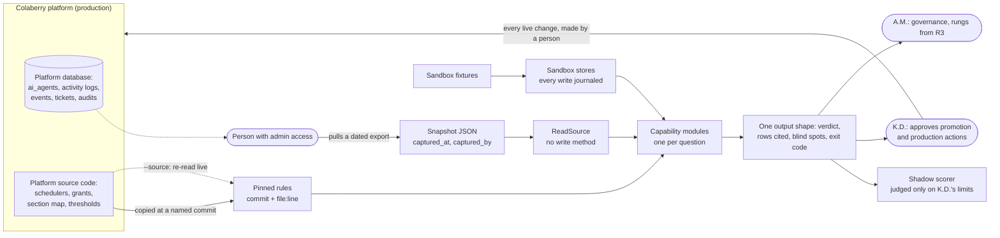
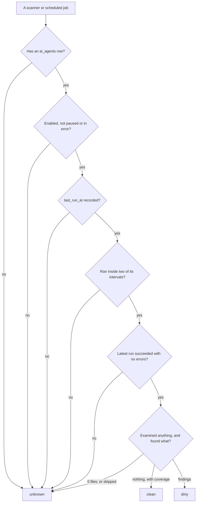

# Architecture

How Ellis is built, and why each part is shaped the way it is. The README has the short version; this page
has the detail. Platform references are to the public Colaberry platform repository.

## System context

Ellis takes two things from the platform: a dated export of the records it needs, and rules copied from the
platform's source code at a named commit. It holds no database credentials and has no network path to the
platform. A person with admin access pulls the export.

## Five layers, each with one job

| Layer | Job | Code |
|---|---|---|
| 1. Input | A dated JSON export with a capture time and who captured it. A snapshot missing a required table is refused, not read as empty. | [`readSource.ts`](../../src/readSource.ts), [`accessSnapshot.ts`](../../src/access/accessSnapshot.ts), [`examples/`](../../examples) |
| 2. Read boundary | Capabilities see the platform only through `ReadSource`, which can find and list rows but cannot change them. Errors are classified as `SourceUnavailable` or `ContractViolation`. | [`readSource.ts`](../../src/readSource.ts), [`records.ts`](../../src/records.ts) |
| 3. Pinned platform knowledge | Rules copied from the platform's code, each with the commit and file:line it came from: agent grants, the admin section map, the retention sweeps, the timer inventory, alert thresholds and the health score formula. | [`agentGrants.ts`](../../src/grants/agentGrants.ts), [`sectionMap.ts`](../../src/access/sectionMap.ts), [`sweepCatalogue.ts`](../../src/retention/sweepCatalogue.ts), [`inventory/`](../../src/inventory) |
| 4. Capabilities | One module per capability, a function from snapshot to report. Changes happen only in sandbox stores that journal every write. | [`capabilities/`](../../src/capabilities), [`sandbox/`](../../src/sandbox) |
| 5. Output | Every check returns one envelope: a shared verdict, a severity set only by K.D.'s table, the rows behind it and what it could not see ([decision 006](../decisions/006-one-output-shape-for-every-tool.md)). Each command exits with a code per state, so a scheduler or a person can act on it without parsing text. A shadow scorer compares recorded verdicts with approved outcomes ([shadow evaluation](../shadow-evaluation.md)). | [`output/`](../../src/output), [`cli/`](../../src/cli), [`shadow/`](../../src/shadow) |

## The core rule: unknown is checked before clean

The platform's own monitors repeatedly called a silent scanner healthy. Ellis asks every reason a source
could be silent before it looks at any result, so "nothing found" and "nothing looked" are never confused.
This is the rule in the security rollup and the security posture scan
([decision 002](../decisions/002-unknown-is-not-healthy.md)).

## Where change is allowed

Nothing in Ellis writes to the platform. Change happens only inside a sandbox, at three levels:

| Level | What changes, and where | Examples |
|---|---|---|
| R1 | A baseline test in a fresh directory under Node's permission model: its own folder only, no other programs, no network | bug fix dispatch, the idempotency harness ([`baselineRunner.ts`](../../src/sandbox/baselineRunner.ts)) |
| R3 | A person starts one sandbox operation, with a named operator | schema comparison, proposed timer rows applied to a sandbox registry, a supplied backup restored into a proven-isolated target |
| R4 | A multi-step task run end to end on a sandbox copy, with every write journaled and a second run required to change nothing | auto-repair and ticket resolution as first releases, and the R4 rungs of 13 more capabilities ([`sandbox/`](../../src/sandbox)) |

The [status page](../STATUS.md) counts the higher-autonomy rungs built this way; the [Capability Map](../artifacts/ellis-capability-map.pdf) lists
each one with its commit. Moving any of them into production is a separate step that a person approves
([decision 001](../decisions/001-read-only-first-sandbox-for-change.md)), and no capability has an approved level on
record yet.

## Dependencies

None at run time. Node 23.6 or later runs the TypeScript directly; `typescript` and `@types/node` are
development dependencies for the type check. CI runs the type check, the tests and a check that the README's
figures match the repository ([`.github/workflows/ci.yml`](../../.github/workflows/ci.yml)).
