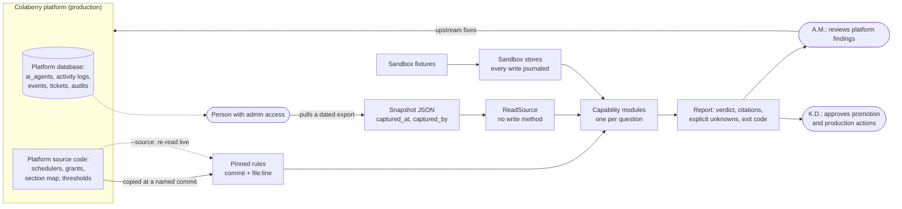
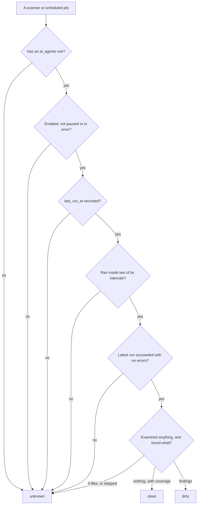

# Architecture

How Ellis is built, and why each part is shaped the way it is. The README has the short version; this page
has the detail. Platform references are to the public Colaberry platform repository.

## System context

Ellis takes two things from the platform: a dated export of the records it needs, and rules copied from the
platform's source code at a named commit. It holds no database credentials and has no network path to the
platform. A person with admin access pulls the export.

## Five layers, each with one job

| Layer | Job | Code |
|---|---|---|
| 1. Input | A dated JSON export with a capture time and who captured it. A snapshot missing a required table is refused, not read as empty. | [`readSource.ts`](../../src/readSource.ts), [`accessSnapshot.ts`](../../src/access/accessSnapshot.ts), [`examples/`](../../examples) |
| 2. Read boundary | Capabilities see the platform only through `ReadSource`, which can find and list rows but cannot change them. Errors are classified as `SourceUnavailable` or `ContractViolation`. | [`readSource.ts`](../../src/readSource.ts), [`records.ts`](../../src/records.ts) |
| 3. Pinned platform knowledge | Rules copied from the platform's code, each with the commit and file:line it came from: agent grants, the admin section map, the retention sweeps, the timer inventory, alert thresholds and the health score formula. | [`agentGrants.ts`](../../src/grants/agentGrants.ts), [`sectionMap.ts`](../../src/access/sectionMap.ts), [`sweepCatalogue.ts`](../../src/retention/sweepCatalogue.ts), [`inventory/`](../../src/inventory) |
| 4. Capabilities | One module per capability, a function from snapshot to report. Changes happen only in sandbox stores that journal every write. | [`capabilities/`](../../src/capabilities), [`sandbox/`](../../src/sandbox) |
| 5. Output | Every verdict carries citations (table and row id). Each command exits with a code per state, so a scheduler or a person can act on it without parsing text. | [`cli/`](../../src/cli) |

## The core rule: unknown is checked before clean

The platform's own monitors repeatedly called a silent scanner healthy. Ellis asks every reason a source
could be silent before it looks at any result, so "nothing found" and "nothing looked" are never confused.
This is the rule in the security rollup and the security posture scan
([decision 002](../decisions/002-unknown-is-not-healthy.md)).

## Where change is allowed

Nothing in Ellis writes to the platform. Three capabilities change state, each only inside a sandbox:

| Capability | Sandbox | What proves it safe |
|---|---|---|
| Orchestration auto-repair (R4) | [`sandboxStore.ts`](../../src/sandbox/sandboxStore.ts): a copy of the three tables a repair can touch | each changed value is read back after the run (`orchestrationAutoRepair.ts:92`), and a second run makes no change, counted from the journal |
| Agent ticket auto-resolution (R4) | [`ticketSandbox.ts`](../../src/sandbox/ticketSandbox.ts): a copy of the ticket queue | a close and its evidence comment are one journal entry; a second run closes nothing more |
| Bug fix dispatch (R1) | [`baselineRunner.ts`](../../src/sandbox/baselineRunner.ts): a fresh directory under Node's permission model | the test can read and write only its own directory, and must fail for the reported reason before any fix |

Moving any of these into production is a separate step that K.D. approves
([decision 001](../decisions/001-read-only-first-sandbox-for-change.md)).

## Dependencies

None at run time. Node 23.6 or later runs the TypeScript directly; `typescript` and `@types/node` are
development dependencies for the type check. CI runs the type check, the tests and a check that the README's
figures match the repository ([`.github/workflows/ci.yml`](../../.github/workflows/ci.yml)).
